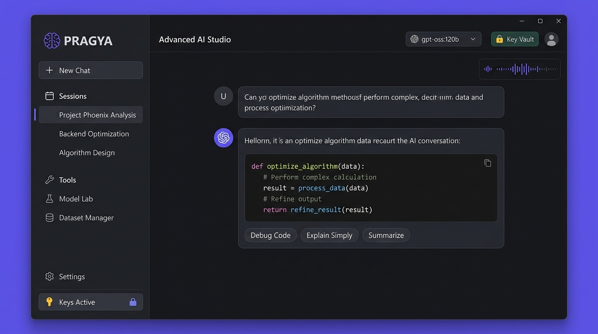

<div align="center">

# PRAGYA — Divya Mati Tantra
### *Next-Generation Intelligent AI Studio Powered by Ollama Cloud*


<br/>

[](https://ollama.com)
[](https://python.org)
[](https://microsoft.com/windows)
[]()
[](https://ollama.com/library)

<p align="center">
  <b>PRAGYA</b> (प्रज्ञा — <i>Divya Mati Tantra</i>) is an ultra-fast, portable desktop AI Studio crafted for developers, researchers, and creators. Built with high-contrast eye-comfort aesthetics, automated multi-key quota failover, voice dictation, document attachments, and real-time cloud inference powered by <b>Ollama Cloud</b>.
</p>

</div>

---

## 📸 Software Interface Tour

<div align="center">
  
</div>

### 🌟 Key Highlights at a Glance
- 🎨 **Eye-Comfort Dark Slate Theme**: Specially calibrated warm slate palette (`#18191c`, `#26282e`, `#30333a`, `#6366f1`) engineered to eliminate glare and eye fatigue during marathon coding and reading sessions.
- ⚡ **Real-Time Token Streaming**: Watch responses materialize with smooth typing animation, live latency timers, token counters, and generation speed badges.
- 🎙️ **Natural Voice Input & Speech Synthesis**: Talk to PRAGYA using hands-on voice dictation and listen to natural text-to-speech output with instant stop controls.
- 📎 **Document & Code Attachment Hub**: Attach `.py`, `.js`, `.json`, `.txt`, `.csv`, `.md`, or full `.pdf` files. Code and documents are auto-parsed and injected into context with 1-click token safety guards.
- 🗂️ **Multi-Session Chat History Drawer**: Manage multiple independent conversations with autosave (`chat_sessions/*.json`), instant switching, and collapsible sidebar (`☰ Chats`).
- ⚡ **Quick Prompt Library**: 1-click prompt chips (`🐛 Debug Code`, `📝 Summarize`, `🌐 Explain Simply`, `⚡ Optimize`, `✍️ Draft Email`) for rapid workflow acceleration.
- 🌐 **Startup Internet Guard**: Automatic network probing on launch. If offline, presents a soothing retry overlay with background auto-reconnection.
- ⚠️ **Safe Exit Confirmation**: Custom modal dialog prevents accidental window closing during critical work.

---

## 🦙 Heartfelt Tribute & Special Thanks to Ollama

<div align="center">
  
</div>

<br/>

> ### *"Standing on the shoulders of giants."*
> 
> A sincere, heartfelt thank you to the extraordinary team at **[Ollama](https://ollama.com)** for revolutionizing the open AI ecosystem.
>
> By providing accessible, blisteringly fast cloud inference for premier open-weights models (including `gpt-oss:120b`, `gemma4:31b`, `nemotron-3-nano:30b`, and `gpt-oss:20b`), Ollama has democratized cutting-edge intelligence for developers across the globe.
>
> **PRAGYA** is built upon Ollama's reliable API surface and stands as a tribute to open-source innovation, community-driven technology, and accessible computing for everyone.

---

## 🏛️ Philosophy & Vedic Origins

- **प्रज्ञा (Pragya / Prajna)**: In ancient Sanskrit philosophy, *Pragya* signifies the highest state of supreme wisdom, intuitive discernment, and pure intellect.
- **दिव्य मति तन्त्र (Divya Mati Tantra)**: A systemic framework (*Tantra*) harnessing divine intelligence (*Divya Mati*) to solve intricate real-world computational challenges.

---

## 🔑 Multi-Key Vault & Quota Failover Engine

<div align="center">
  <kbd>🔑 Key #1 (Active)</kbd> ➔ <i>[Quota Limit Reached]</i> ➔ <kbd>🔄 Auto-Switch</kbd> ➔ <kbd>🔑 Key #2 (Active)</kbd>
</div>

### 1 Account = 1 Capacity Limit Rule:
- Generating multiple keys inside a single Ollama account shares the exact same quota pool.
- **Unlimited Capacity Workflow**: When one account reaches its capacity threshold, simply register another account on `https://ollama.com` with a secondary email, copy its key, and add it to PRAGYA's Key Vault.
- PRAGYA's **Auto-Failover** engine automatically switches to the next account's key without interrupting your workflow.

### 4-Step Beginner Onboarding Guide:
1. **Step 1: Open Ollama**: Visit `https://ollama.com` and sign in / sign up with your email.
2. **Step 2: Go to API Keys**: Open `https://ollama.com/settings/keys` or click your avatar and select **API Keys**.
3. **Step 3: Generate Key**: Click **+ New Key** and copy your secret key string.
4. **Step 4: Paste into PRAGYA**: Paste in PRAGYA's Key Vault or click **📋 Quick Paste & Save Now** for instant 1-click activation.

---

## 🚀 Quick Start (Zero Python Setup Required)

This portable distribution runs natively on any 64-bit Windows machine without needing Python, pip, or virtual environments installed.

### Option 1: Run the Executable
1. Open this folder.
2. Double-click **`PRAGYA.exe`**.
3. Add your Ollama API key via the 4-step guide in the **Key Vault**.
4. Start exploring!

### Option 2: Share with Anyone
- Share the complete `PRAGYA` folder or `PRAGYA_Portable.zip` with friends or colleagues.
- Extract anywhere (Desktop, USB drive, external disk) and run immediately.

---

## 🛠️ Project Structure

```text
PRAGYA/
├── PRAGYA.exe                # Standalone native 64-bit application executable
├── _internal/                # Bundled Python runtime, DLLs, and graphical assets
├── assets/                   # Software branding, banners, and icons
│   ├── pragya_icon.ico       # Application icon
│   ├── pragya_icon.png       # High-resolution PNG logo
│   ├── hero_banner.jpg       # Cyber-mandala PRAGYA hero banner
│   ├── app_preview.jpg       # Desktop studio UI interface preview
│   └── ollama_tribute.jpg    # Ollama thank-you & tribute banner
├── chat_sessions/            # Local JSON chat session transcripts
├── .env.example              # Configuration template
├── HOW_TO_RUN.txt            # Quick reference guide
└── README.md                 # Professional documentation & gallery
```

---

## 💻 Git Setup Instructions

To push this standalone `PRAGYA` folder to your GitHub repository:

```bash
# 1. Initialize Git in the PRAGYA folder
git init

# 2. Add files (the included .gitignore will safely ignore .env secrets)
git add .

# 3. Commit your release
git commit -m "feat: release PRAGYA - Divya Mati Tantra portable edition"

# 4. Link your remote GitHub repository
git remote add origin https://github.com/YOUR_USERNAME/PRAGYA.git

# 5. Push to GitHub
git branch -M main
git push -u origin main
```

---

## 📜 License & Credits

- **Core Application**: PRAGYA — Divya Mati Tantra
- **Inference Engine**: [Ollama Cloud](https://ollama.com)
- **GUI Framework**: [CustomTkinter](https://github.com/TomSchimansky/CustomTkinter)
- **License**: Released under the MIT License for open innovation.
